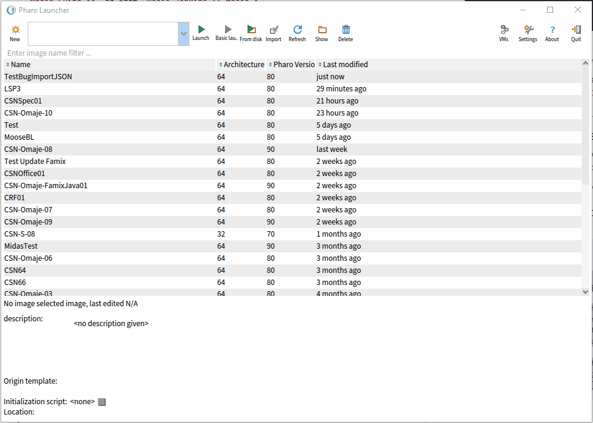

import { Aside, Steps } from '@astrojs/starlight/components';

Moose runs inside a Pharo image.
The easiest way to get one is to use the Pharo Launcher.

## Installation

<Steps>

1. Download and install the Pharo Launcher from the [Pharo website](https://pharo.org/web/download).

2. Open the Pharo Launcher, click on `New`, then select a Moose image in the `Moose` category.

    Take the highest *stable* version available.
    The [Readme of the Moose project](https://github.com/moosetechnology/Moose#readme) lists the current versions.

    

3. Once the image is downloaded, select it and click on `Launch`.

4. Moose opens. You should see the Pharo world with a **Moose** entry in the top menu bar: it gives access to all the Moose tools.

</Steps>

You are ready for [your first analysis](/beginners/moose-in-action/).

## Install a specific version of Moose

<details>
<summary>Add all Moose GitHub releases to the Pharo Launcher</summary>

By default, the Pharo Launcher only lists the most recent Moose versions.
If you need a specific release, you can add it as a template source:

<Steps>

1. Open the Pharo Launcher.
2. Open a playground (<kbd>Ctrl</kbd> + <kbd>O</kbd>, <kbd>Ctrl</kbd> + <kbd>W</kbd>).
3. Execute the following piece of code, after adapting the version numbers and URLs to the [release](https://github.com/moosetechnology/Moose/releases) you need:

    ```smalltalk
    | sources |

    sources := {
        "Add Moose"
        PhLTemplateSource new
            type: #URLGroup;
            name: 'Moose 12';
            templates: {
            PhLTemplateSource new
                type: #URL;
                name: 'Moose12-Pharo12';
                url: 'https://github.com/moosetechnology/Moose/releases/download/v12.0.0/Moose12-stable-Pharo64-12.zip';
                yourself.
            PhLTemplateSource new
                type: #URL;
                name: 'Moose12-Pharo13';
                url: 'https://github.com/moosetechnology/Moose/releases/download/v12.0.0/Moose12-stable-Pharo64-13.zip';
                yourself.
    } }.

    PhLUserTemplateSources sourcesFile writeStreamDo: [ :s |
        (STON writer on: s)
            newLine: String lf;
            prettyPrint: true;
            nextPut: sources ]
    ```

4. Close the playground.
5. Select `New >> Moose >> Your version`.

    

</Steps>

</details>

<Aside type="tip">
Something went wrong? Ask on [Discord](https://discord.gg/QewZMZa), the community is happy to help.
</Aside>
