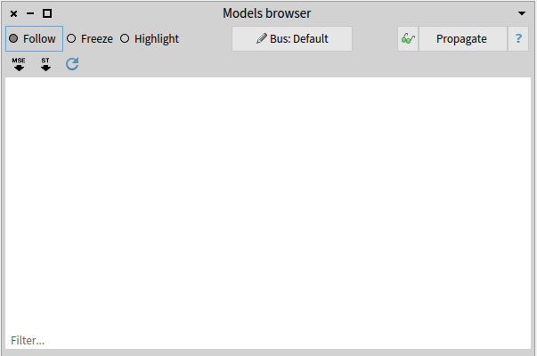
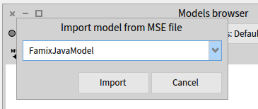
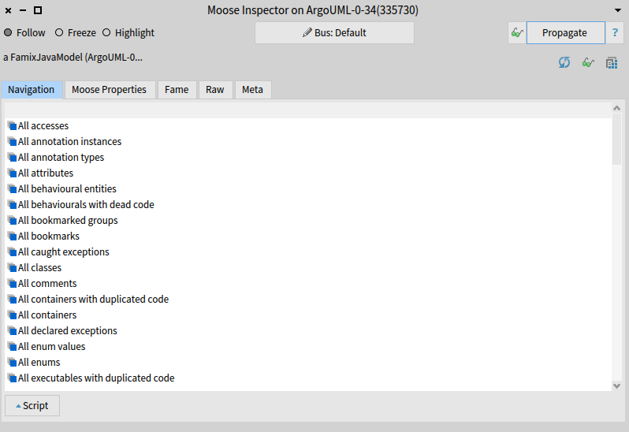
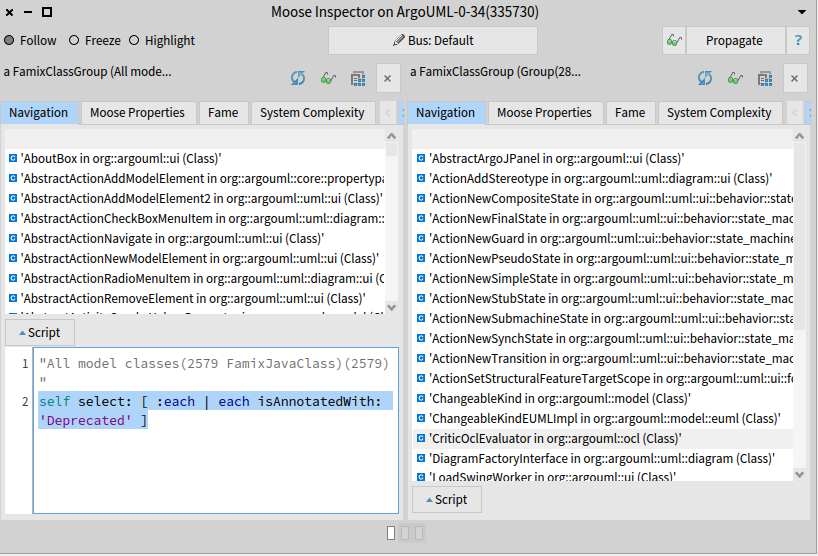
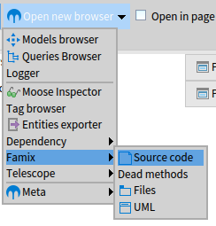
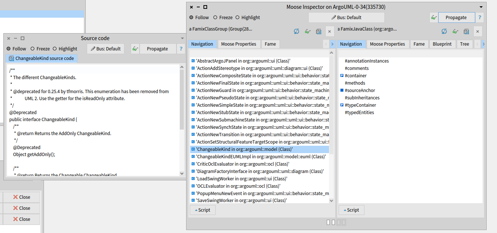
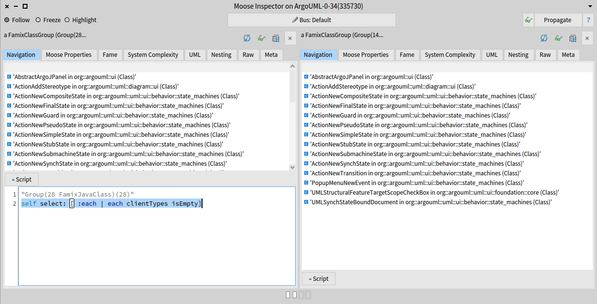

import { Aside, Steps, Tabs, TabItem } from '@astrojs/starlight/components';

In this tutorial, we perform a first analysis on a real case study: ArgoUML, an open-source Java project.

The system contains some deprecated classes.
A typical question is: **which of these classes can we remove?**
Essentially, this boils down to finding the classes annotated with `@Deprecated` and then selecting those that are not used anywhere (we ignore reflection for this exercise).

Before starting, make sure you have [installed Moose](/beginners/install-moose/).

## Get the model of ArgoUML

As explained in [What is Moose?](/beginners/what-is-moose/), we first need a model of the system.

<Aside type="tip" title="Shortcut">
To start right away, [download the ArgoUML model](/beginners/moose-in-action/ArgoUML-0-34.json) and go to [Load the model in Moose](#load-the-model-in-moose).
</Aside>

<details>
<summary>Build the model yourself with VerveineJ</summary>

To build the model, we use [VerveineJ](/developers/parsers/verveinej/), the Java parser of Moose.
You can use its [docker image](https://github.com/Evref-BL/VerveineJ-Docker) or install it on your computer:

<Steps>

1. Download and unzip the [latest release of VerveineJ](https://github.com/moosetechnology/VerveineJ/releases).
2. Create an `ArgoUML-0-34` folder.
3. Download the [ArgoUML version 0.34 sources](https://github.com/argouml-tigris-org/argouml/releases/download/VERSION_0_34/ArgoUML-0.34-src.zip) and place them in the `ArgoUML-0-34/src` folder.
4. Download the [ArgoUML version 0.34 libraries](https://github.com/argouml-tigris-org/argouml/releases/download/VERSION_0_34/ArgoUML-0.34-libs.zip) and place them in the `ArgoUML-0-34/libs` folder.
5. From the `ArgoUML-0-34` folder, run VerveineJ:

    <Tabs syncKey="os">
    <TabItem label="macOS / Linux">
    ```sh
    path/to/VerveineJ/verveinej.sh -format json -o ArgoUML-0-34.json -autocp ./libs ./src
    ```
    </TabItem>
    <TabItem label="Windows">
    ```sh
    path\to\VerveineJ\verveinej.bat -format json -o ArgoUML-0-34.json -autocp ./libs ./src
    ```
    </TabItem>
    </Tabs>

</Steps>

You get an `ArgoUML-0-34/ArgoUML-0-34.json` file containing the model of ArgoUML.

</details>

## Load the model in Moose

<Steps>

1. In Moose, open the *Models browser* from the Moose menu.

    

2. Click on the JSON button on the top right and select the `ArgoUML-0-34.json` file.

3. Moose asks which Famix meta-model the file follows.
    ArgoUML is a Java project, so select `FamixJavaModel`.

    

4. *(Optional)* To see the source code of the entities, point the model to the sources folder:
    right-click on the `ArgoUML-0-34` model, choose `Utilities >> Set root folder`, and select the `ArgoUML-0-34` folder.

</Steps>

Now we are ready to query our system.

## Find deprecated classes

We first look for the deprecated classes.
Inspect the model with a right-click on the model and `Inspect`.



To retrieve the deprecated classes, select the `All model classes` entry.
Then, open the script area and type the following script:

```smalltalk
self select: [ :each | each isAnnotatedWith: 'Deprecated' ]
```

Select the script, and execute it with <kbd>Ctrl</kbd> + <kbd>G</kbd>.



In the right pane, you get the list of the 28 deprecated classes of ArgoUML.

## Show source code

To make sure that we indeed got deprecated classes, let's look at the source code of one of them.
Select one entity and open the *Source code* browser (`Specialized Browsers >> Famix >> Source code`).



Then, click on the **Propagate** button of the inspector: the source code of the selected class appears in the *Source code* browser.

<Aside type="note">
This requires Moose to know where the files are on your disk (see step 4 of [Load the model in Moose](#load-the-model-in-moose)).
</Aside>



## Analyze the result

We now need to check which of the 28 deprecated classes are not used.
In terms of clients and providers: which deprecated classes have no client classes?
Go back to the inspector pane listing the 28 classes, open the script area again, and execute:

```smalltalk
self select: [ :each | each clientTypes isEmpty ]
```

We get 14 classes that can be removed immediately.



To retrieve the other classes, execute:

```smalltalk
self select: [ :each | each clientTypes isNotEmpty ]
```

This gives 14 classes that cannot be removed because they are still used.

## What's next?

You have performed your first analysis with Moose.
Now, [analyze your own project](/beginners/analyze-your-project/).

---

*This tutorial was first written for [the Moose book](http://www.themoosebook.org/book).*
