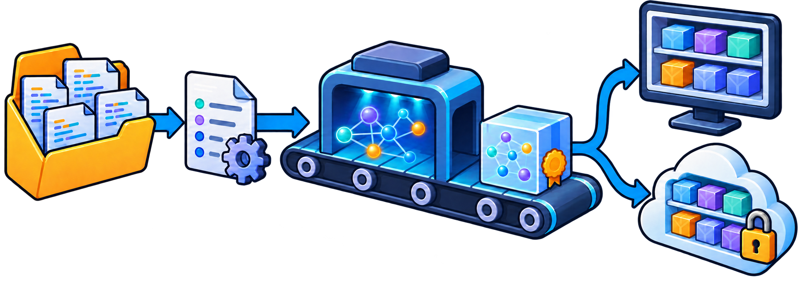

---
authors:
- GabrielDarbord
title: "Building and sharing Moose models with MooseNexus"
description: "Build repeatable Moose models from source projects, automate them with the MooseNexus CLI, and share them through artifact registries."
date: 2026-10-21
tags:
- Moose
- Famix
- infrastructure
---

Building a Moose model is often only the first step of an analysis. We also need to know which source project produced it, which dependencies were used, which tools extracted it, and how another person can build or retrieve the same model.

[MooseNexus](https://github.com/moosetechnology/MooseNexus) brings these steps into one repeatable workflow. It builds Moose models, records how they were produced, stores them as versioned artifacts, and can share them through an artifact registry.

This post first uses the MooseNexus API from a Moose image, then performs the same kind of build with the command-line interface. The final section explains how an artifact registry can store and distribute the resulting models and images.

## What MooseNexus does

MooseNexus sits between a source project and the Moose model that we want to analyze.



*From source project to versioned model artifact: MooseNexus records the result locally and can publish it to a shared artifact registry.*

A build starts with two pieces of information:

- the directory containing the source project;
- coordinates that identify it: a group, a name, and a version.

MooseNexus then imports the project metadata, resolves the dependencies needed for extraction, runs the model extractor, and records the result. For Java projects it can recognize Maven and Gradle projects. Projects without a supported build descriptor can be described explicitly as unmanaged projects.

The result is more than a model file. A model artifact also records its source-project identity, dependency-resolution result, and build provenance, including the Moose, Pharo, MooseNexus, and extractor versions. This information makes it possible to inspect how a model was produced and to select a compatible environment later.

By default, projects and artifacts are kept in a local repository below `~/.moose`. The important principle is similar to Maven coordinates: `com.example:demo:1.0.0` identifies one version of a project independently of the machine on which it was analyzed.

## Build a model with the API

The main API entry point is `MooseNexusBuildSpec`. A build specification describes the intended result; MooseNexus handles the individual import, dependency, extraction, and storage steps.

### 1. Load MooseNexus

For a Java project, load the Java runtime group in a Moose image:

```smalltalk
Metacello new
	githubUser: 'moosetechnology'
	project: 'MooseNexus'
	commitish: 'v1.x.x'
	path: 'src';
	baseline: 'MooseNexus';
	load: 'Java'.
```

The floating `v1.x.x` tag selects the newest compatible version in the MooseNexus 1.x series. Use an exact release tag when the build must be fully reproducible.

### 2. Identify the source project

Let us build a model for a project located at `/path/to/demo`. We first give it stable coordinates:

```smalltalk
coordinates := MooseNexusCoordinates
	group: 'com.example'
	name: 'demo'
	version: '1.0.0'.
```

The coordinates identify the project in the local repository and, later, in an artifact registry. They do not need to be the same as Maven or Gradle coordinates, although using the same identity can be convenient.

### 3. Describe the build

Create a build specification from the coordinates and source directory:

```smalltalk
spec := MooseNexusBuildSpec
	coordinates: coordinates
	sourceDirectory: '/path/to/demo' asFileReference.

spec
	modelName: 'demo-model';
	modelComment: 'Model used for the architecture analysis'.
```

The source directory can be anywhere; it does not have to be a Git checkout. For a Maven or Gradle project, MooseNexus detects the appropriate importer from the directory. The explicit coordinates remain the identity of the MooseNexus artifact.

This separation is useful: the build tool describes how the software project is assembled, while the build specification describes the model artifact that we want MooseNexus to produce.

### 4. Execute the build

Execute the specification in the default repository:

```smalltalk
result := spec execute.
```

This performs the complete workflow and records the project below the default `~/.moose` repository. The result gives access to three useful objects:

```smalltalk
result project.
result modelArtifact.
result dependencyResolutionResult.
```

Use `executeIn:` with a `MooseNexusRepository` when the artifact should be stored elsewhere:

```smalltalk
repository := MooseNexusRepository
	localDirectory: '/path/to/model-repository' asFileReference.

result := spec executeIn: repository.
```

### 5. Load the model in Moose

Building records the artifact but does not force it into the current image. Import it explicitly when it is time to analyze it:

```smalltalk
model := result project importModel: result modelArtifact.
```

The imported model is registered in `MooseModel root`. Keeping the build and import steps separate also lets headless jobs produce artifacts without retaining a full analysis image.

For most clients, `execute` or `executeIn:` is the API to keep. MooseNexus also exposes the individual build phases, but those are mainly useful when an application needs custom orchestration.

## Build from the command line

The [MooseNexus CLI](https://github.com/moosetechnology/MooseNexus-CLI) runs the same ideas without requiring us to prepare a Moose image by hand. It creates an isolated workspace, provisions a compatible Moose/Pharo runtime, loads MooseNexus, executes a build specification, and stores the result.

Install it with npm. The CLI requires Node.js 22 or later:

```bash
npm install --global @moosetechnology/moosenexus
```

For Java extraction, the default setup also requires Docker. We can check the available tools before starting a build:

```bash
moosenexus doctor
```

The interactive wizard is the easiest way to discover the commands:

```bash
moosenexus --wizard
```

For a Maven or Gradle project, a direct build can be as small as:

```bash
moosenexus build-model \
  com.example:demo:1.0.0 \
  /path/to/demo
```

This creates a model artifact and installs it in the local MooseNexus repository. To create a ready-to-open Moose image containing the imported model instead, use `build-image`:

```bash
moosenexus build-image \
  com.example:demo:1.0.0 \
  /path/to/demo \
  --adopt
```

The built image is first stored as an immutable artifact. `--adopt` also copies it to the standard Pharo images directory, where it becomes a working image that we can open and modify.

The two outputs serve different needs:

- a **model artifact** is smaller and can be imported into a compatible existing Moose image;
- an **image artifact** is a ready-to-open environment containing the model and its compatible runtime.

### What an image artifact contains

An image artifact is selective rather than a copy of the complete build workspace. Its portable ZIP contains:

- at its root, the `.image` file, its `.changes` file when available, the available Pharo `.sources` files, `meta-inf.ston`, `pharo.version`, and a CLI build report;
- under `pharo-local/MooseNexus/`, the recorded project metadata, model artifact, and a copy of the analyzed source project.

Other image-local directories, such as `pharo-local/iceberg`, and the Pharo VM are not included. MooseNexus does not scan these files for credentials or remove secrets: the source copy, saved image, or changes file may contain sensitive information. Review an artifact before publishing it.

### Reuse an image artifact

An installed image artifact can be adopted several times, much like making working copies from a template. Each adoption creates a separate writable image while leaving the repository artifact unchanged:

```bash
moosenexus adopt-image com.example:demo:1.0.0
moosenexus adopt-image com.example:demo:1.0.0 --adopt-as demo-alice
```

By default, these copies are placed in the standard Pharo images directory and appear in Pharo Launcher. This is not a Launcher template: MooseNexus copies the image files and launcher metadata from an installed artifact. The recorded project and source copy remain in the local MooseNexus repository rather than being duplicated into every adopted image.

Use `moosenexus artifacts` to see what is installed locally. Build options can also be kept in a YAML file and passed with `--config`, which is preferable for repeatable scripts and continuous integration. `--dry-run` shows the resolved workflow without executing it, and `--json` produces machine-readable output for automation.

## Share artifacts through a registry

The important need here is artifact storage and distribution: a shared place where versioned Moose models and images can be published, found, and retrieved.

MooseNexus currently implements this with the [Open Container Initiative](https://opencontainers.org/) distribution conventions. Although OCI is best known for container images, its registries can store other versioned artifacts as well. Reusing that standard gives MooseNexus an existing upload, download, authentication, and access-control ecosystem instead of inventing a Moose-specific artifact server.

An organization can therefore use infrastructure it may already have—such as Harbor, Sonatype Nexus, Artifactory, or another OCI-compatible registry—to distribute Moose models and images. MooseNexus defines what goes into the artifact, while [ORAS](https://oras.land/) performs the standard registry upload and download.

A MooseNexus model bundle contains:

- the exported model;
- an archive of the analyzed sources;
- the project metadata;
- the model manifest, including build and extractor provenance.

Including the sources makes the artifact inspectable and helps reproduce the model, but it is also important to remember before publishing: a model bundle can contain proprietary source code. Use a registry and access policy appropriate for the project.

First authenticate ORAS with the target registry:

```bash
oras login registry.example.com
```

Then add a registry and namespace to the build command:

```bash
moosenexus build-model \
  com.example:demo:1.0.0 \
  /path/to/demo \
  --registry registry.example.com \
  --namespace team/models
```

MooseNexus still installs the artifact locally and also publishes it under a reference derived from the project coordinates, for example:

```text
registry.example.com/team/models/moosenexus/com.example/demo:1.0.0
```

Another machine can retrieve the model with the same coordinates:

```bash
moosenexus pull-model \
  com.example:demo:1.0.0 \
  --registry registry.example.com \
  --namespace team/models
```

`pull-model` installs the artifact in the local MooseNexus repository. It can then be imported through the API shown earlier. Use `pull-image ... --adopt` when the published artifact is a Moose image and a ready-to-open copy is wanted instead.

Publication is always explicit: building locally does not silently upload anything. MooseNexus also keeps registry credentials outside its own configuration and relies on the authenticated ORAS installation.

## API or CLI?

Both interfaces use the same project coordinates, build specification, repository, and artifact concepts.

| Use the API when… | Use the CLI when… |
| --- | --- |
| the build is part of a Moose application | the build should start from a clean, isolated runtime |
| an image needs custom import or extraction policy | a shell script or CI job should run the build |
| the resulting model will be analyzed immediately | a model or ready-to-open image should be produced and shared |

The API is the stable foundation, and the CLI automates the surrounding runtime setup. Starting with the CLI is often easier; moving to a Smalltalk build specification gives more control without changing the underlying model-artifact workflow.

MooseNexus therefore turns a one-off model extraction into a named, versioned, and shareable build result. That becomes especially valuable when a model must outlive the image in which it was first created—or when another person, machine, or CI job needs to produce the same analysis input.
