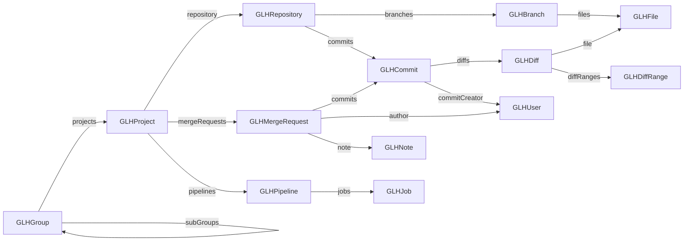

Every importer fills a `GLHModel` (a `MooseModel`).
All entities inherit from `GLHEntity` and use the same classes whatever the platform: a GitHub pull request is a `GLHMergeRequest`, a GitHub organization is a `GLHGroup`.

## Main entities



| Entity | Represents | Key attributes | Key relations |
| --- | --- | --- | --- |
| `GLHGroup` | GitLab group, GitHub organization, Bitbucket project | `id`, `name`, `web_url`, `visibility` | `projects`, `subGroups`, `group` (parent) |
| `GLHProject` | a project / repository on the platform | `id`, `name`, `web_url`, `archived`, `topics` | `group`, `repository`, `mergeRequests`, `pipelines`, `issues`, `releases`, `creator`, `contributors` |
| `GLHRepository` | the Git repository of a project | — | `project`, `branches`, `commits`, `tags` |
| `GLHBranch` | a branch | `name`, `sha` | `repository`, `commits`, `files` |
| `GLHCommit` | a commit | `id` (SHA), `short_id`, `title`, `message`, `author_name`, `author_email`, `committed_date`, `authored_date`, `additions`, `deletions`, `web_url` | `repository`, `parentCommits`, `childCommits`, `diffs`, `commitCreator`, `commitedMergeRequest`, `squashedMergeRequest`, `jobs`, `tags` |
| `GLHDiff` | the change of one file in a commit or merge request | `old_path`, `new_path`, `new_file`, `renamed_file`, `deleted_file`, `diffString` | `commit`, `mergeRequest`, `file`, `diffRanges` |
| `GLHDiffRange` | a hunk of a diff (`@@ … @@`) | `originalLineRange`, `newLineRange` | `diff`, `changes` |
| `GLHChange` | a line of a hunk: `GLHAddition`, `GLHDeletion`, `GLHLineOfCode` (unchanged) | `sourceCode`, `index`, `relativeIndex` | `diffRange` |
| `GLHFile` | a file: `GLHFileDirectory` or `GLHFileBlob` | `name`, `path` | `branch`, `directoryOwner`, `files` (directories), `diffs` |
| `GLHMergeRequest` | merge request / pull request | `id`, `iid`, `title`, `description`, `state`, `created_at`, `merged_at`, `closed_at`, `source_branch`, `target_branch`, `draft`, `labels`, `approved` | `project`, `commits`, `author`, `merge_user`, `merged_by`, `closed_by`, `reviewers`, `assignees`, `approved_by`, `pipelines`, `diffs`, `note`, `mergedCommit`, `squashCommit` |
| `GLHNote` | a comment on a merge request | `body`, `created_at`, `system`, `resolvable` | `mergeRequest`, `author`, `position`, `suggestions` |
| `GLHPipeline` | a CI pipeline / workflow run | `id`, `status`, `ref`, `sha`, `created_at`, `finished_at`, `duration` | `project`, `jobs`, `user`, `mergeRequest` |
| `GLHJob` | a CI job | `name`, `duration`, `allow_failure`, `web_url` | `pipeline`, `commit`, `user` |
| `GLHUser` | a platform user or a commit author | `id`, `username`, `name`, `public_email`, `bot` | `commits`, `createdMergeRequests`, `reviewedMergeRequest`, `mergerOfMergeRequests`, `contributedProjects`, `launchedPipelines` |
| `GLHTag`, `GLHRelease` | Git tags and platform releases | `name`, `tag_name`, `created_at` | `repository`, `commit`, `project` |
| `GLHIssue`, `GLHMilestone` | platform issues and milestones | `title`, `state`, `due_date` | `project`, `assignees`, `author` |

:::tip
Commit authors that cannot be matched with a platform account are created as `GLHUser`s too. Use `user isRealUser` / `user isFakeUser` to tell them apart.
:::

The full UML diagram of the meta-model is generated automatically by [FamixUMLDocumentor](https://github.com/moosetechnology/FamixUMLDocumentor):


## Navigate and query the model

A `GLHModel` is a Moose model, so all the [MooseQuery](/users/moosequery/) API works on it.

```smalltalk
"All entities of a type"
commits := model allWithType: GLHCommit.
files := model allWithSubTypesOf: GLHFile.

"Entities contained (transitively) in another entity"
projects := group containedEntitiesOfType: GLHProject. "includes sub-groups"
mergeRequests := group containedEntitiesOfType: GLHMergeRequest.
projectCommits := project containedEntitiesOfType: GLHCommit.

"Classic navigation"
project repository branches collect: #name.
commit diffs collect: #new_path.
commit parentCommits.
mergeRequest author username.
```

:::caution[toScope: is deprecated]
Older examples use `toScope:` and `allToScope:`. In recent Moose versions they are deprecated: use `containedEntitiesOfType:` and `allContainedEntitiesOfType:` instead.
:::
