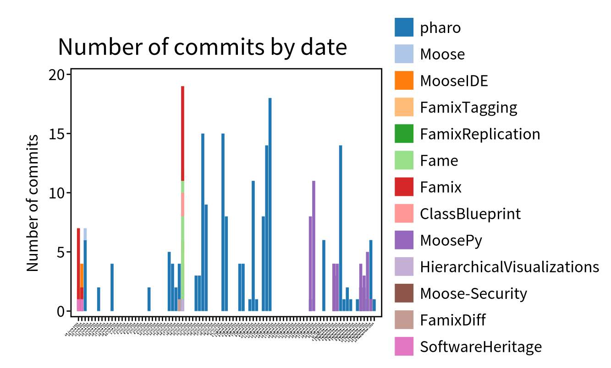

import { Aside } from '@astrojs/starlight/components';

GitProjectHealth adds views to the Pharo inspector and provides [Roassal](https://github.com/pharo-graphics/Roassal) visualizations that you can open or export from a script.

## Inspector tabs

Inspect an entity (`Ctrl+I`) to get these tabs:

| Inspected entity | Tab | Shows |
| --- | --- | --- |
| `GLHGroup` | **Group Quality** | the projects of the group (and sub-groups), green if their last pipeline succeeded, red if it failed |
| group of `GLHGroup`s | **Groups Quality** | the same, for several groups |
| `GLHProject` | **Contributors** | the users who committed in the project |
| `GLHRepository` | **Commits History** | the commit graph (branches and merges) |
| `GLHRepository` | **Commits distribution** | number of commits per day, stacked by author |
| `GLHRepository` | **Weekly Commits** | commits per day of the week |
| `GLHUser` | **Commits distribution** | commits per day, stacked by project |
| `GLHUser` | **Weekly Commits** | commits per day of the week |
| `GLHCommit` | **Commit View**, **File Impact**, **Commits Tree** | the diff of the commit, the impacted files, its child commits |
| `GLHDiff` | **Diff View**, **Files Impacted** | the diff and the impacted files |
| any `GLHEntity` | **Tree** | the containment tree of the entity |



## Visualizations from a script

Each visualization returns a Roassal `RSCanvas` that you can `open`, inspect or export.

### Group quality

```smalltalk
"group: a GLHGroup imported with a platform importer"
canvas := GLHGroupVisualization new forGroup: { group }.
canvas open.
```

The colors can be changed with `passingPipelineColor:`, `failingPipelinecolor:` and `noPipelineColor:`.

### Commits distribution

```smalltalk
commits := (project containedEntitiesOfType: GLHCommit) asOrderedCollection.

"Commits per day, stacked by author (default)"
(GLHCommitDistributionVisualization new forCommits: commits) open.

"Commits per day, stacked by project"
(GLHCommitDistributionVisualization new
  groupCommitBlock: [ :commit | commit repository project ];
  forCommits: commits) open.

"Commits per day of the week, and average per day of the week"
(GLHCommitDistributionByWeekDayVisualization new forCommits: commits) open.
(GLHCommitDistributionAverageByWeekDayVisualization new forCommits: commits) open.
```

### Contributors of a project

```smalltalk
(GLHProjectContributorVisualization new forProject: project) open.
```

## Export

### SVG or PNG

```smalltalk
canvas := GLHGroupVisualization new forGroup: { group }.

canvas svgExporter
  withoutFixedShapes;
  fileName: 'group-health';
  export.

canvas pngExporter
  fileName: 'group-health';
  export.
```

Files are written next to the image.

### CSV

`GLHGroupCSVExporter` exports, for each project of a group and of its sub-groups, the result and the date of its last pipeline:

```smalltalk
csv := GLHGroupCSVExporter new forGroup: group.
'group-health.csv' asFileReference writeStreamDo: [ :stream | stream nextPutAll: csv ].
```

<Aside type="tip">
For metrics per user or per project, use [GitMetricExporter](/users/git-project-health/metrics/#export-metrics-with-gitmetricexporter).
</Aside>
